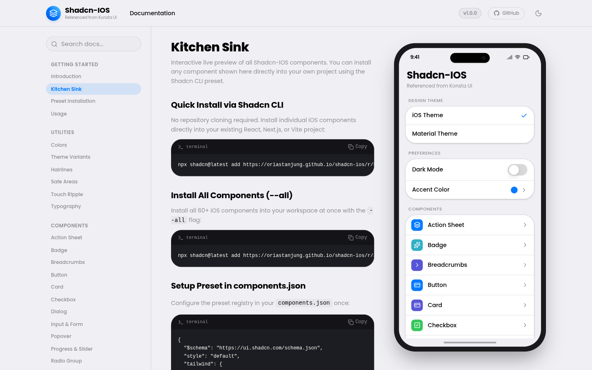
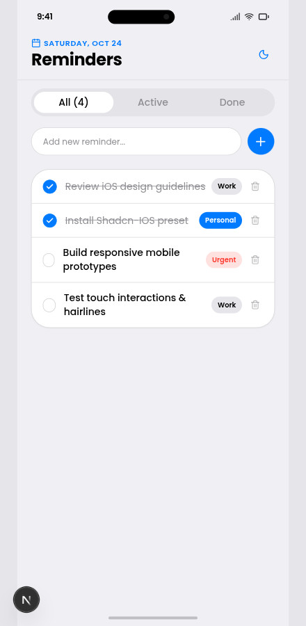
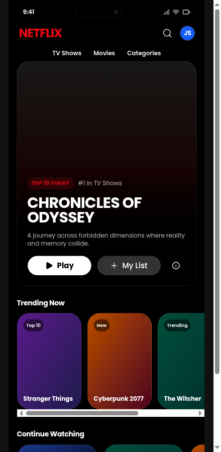
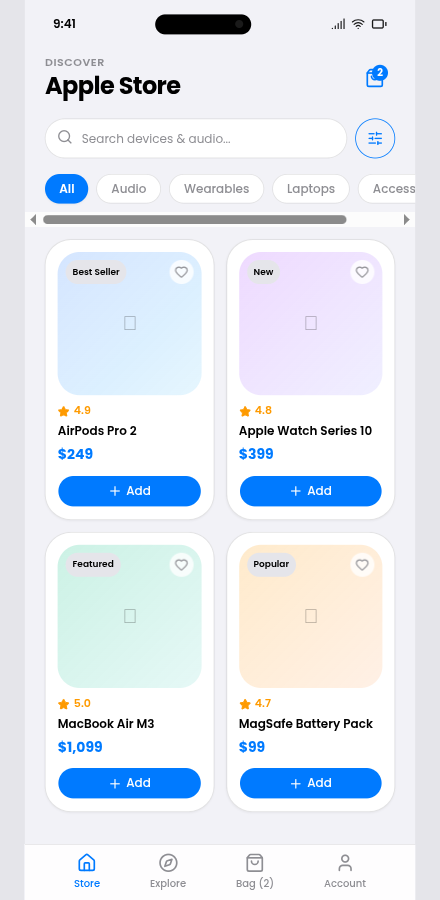
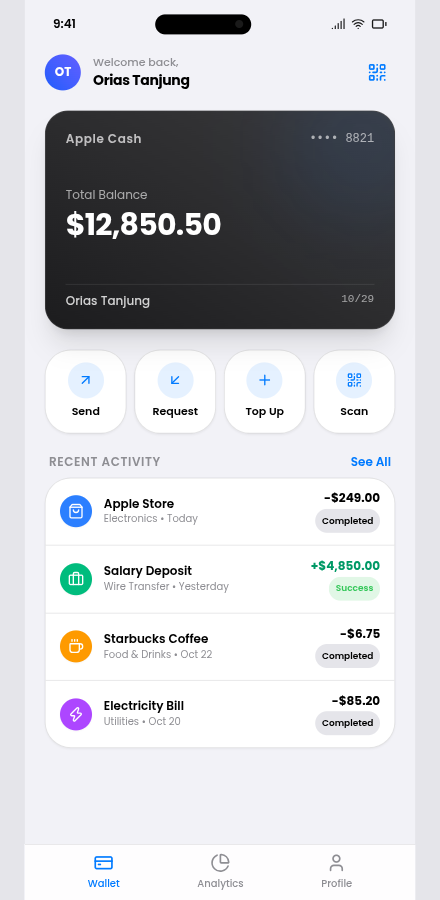

<div align="center">

# Shadcn-IOS

**Konsta UI iOS Cupertino style and design tokens built for shadcn/ui.**

[](https://opensource.org/licenses/MIT)
[](https://www.typescriptlang.org/)
[](https://tailwindcss.com/)
[](https://ui.shadcn.com)

A high-fidelity iOS mobile component preset for shadcn/ui. Built with Radix UI, Base UI, Tailwind CSS v4, and Poppins font typography.

[Documentation & Live Kitchen Sink](https://oriastanjung.github.io/shadcn-ios/)

<br />

<p align="center">
  
</p>

</div>

---

## Highlights

- 📱 **Pure Cupertino Fidelity**: Pill action buttons, rounded switches, segmented controls, centered alert dialogs, and slide-up action sheets.
- ⚡ **Official shadcn Preset**: Install directly with `npx shadcn add`. Zero repository cloning required.
- 🎨 **System Design Tokens**: Apple HIG-aligned color palette (System Blue, Green, Indigo, Purple, Red) and 0.5px hairline borders.
- 🔤 **Poppins Default Font**: Beautiful modern typography scale pre-configured with native Apple SF Pro fallbacks.
- ♿ **Accessible**: Full keyboard navigation, ARIA semantics, and screen-reader compliance via Radix UI & Base UI primitives.

---

## Sample Mobile Applications

Tested and verified in production Next.js 16 and Vite React apps:

| 1. iOS Reminders (Next.js) | 2. Netflix Mobile (Vite React) |
|:---:|:---:|
|  |  |
| *Components: Tabs, Input, Checkbox, Badge, Inset Card* | *Components: Pill Buttons, Badges, Hero Banner, Carousels* |

| 3. Apple Store E-Commerce | 4. Apple Cash E-Wallet |
|:---:|:---:|
|  |  |
| *Components: Search Bar, Category Chips, Product Grid, Price Badges* | *Components: Titanium Card, Quick Action Pills, Grouped Activity List* |

---

## Quick Start (shadcn Preset)

### Option 1: Install All Components (`--all`)

Install the entire suite of 60+ iOS components with a single command:

```bash
npx shadcn@latest add https://oriastanjung.github.io/shadcn-ios/r/all.json --all
```

Or if you have the `@ios` registry configured in your `components.json`:

```bash
npx shadcn@latest add @ios/all --all
```

---

### Option 2: Add Preset Registry to `components.json`

Add the custom registry to your project's `components.json`:

```json
{
  "$schema": "https://ui.shadcn.com/schema.json",
  "style": "default",
  "tailwind": {
    "config": "tailwind.config.js",
    "css": "src/index.css",
    "baseColor": "slate",
    "cssVariables": true
  },
  "registries": {
    "ios": "https://oriastanjung.github.io/shadcn-ios/r"
  }
}
```

Now you can install any component on demand:

```bash
# Single component
npx shadcn@latest add @ios/button

# Multiple components
npx shadcn@latest add @ios/button @ios/switch @ios/card @ios/dialog @ios/sheet
```

---

### Option 3: Direct Component URL

You can also install individual components without configuring `components.json`:

```bash
npx shadcn@latest add https://oriastanjung.github.io/shadcn-ios/r/button.json
npx shadcn@latest add https://oriastanjung.github.io/shadcn-ios/r/switch.json
npx shadcn@latest add https://oriastanjung.github.io/shadcn-ios/r/dialog.json
```

---

## Usage

```tsx
import { Button } from "@/components/ui/button"
import { Switch } from "@/components/ui/switch"
import { Card, CardContent } from "@/components/ui/card"

export default function MobileCard() {
  const [enabled, setEnabled] = React.useState(true)

  return (
    <Card className="rounded-2xl border-border">
      <CardContent className="p-4 flex items-center justify-between">
        <span className="text-sm font-medium">Airplane Mode</span>
        <Switch checked={enabled} onCheckedChange={setEnabled} />
      </CardContent>
    </Card>
  )
}
```

---

## Included Components

| Category | Components |
|---|---|
| **Actions** | `button`, `button-group`, `toggle`, `toggle-group` |
| **Form Controls** | `input`, `input-group`, `input-otp`, `textarea`, `switch`, `checkbox`, `radio-group`, `slider`, `native-select`, `select` |
| **Overlays & Modals** | `dialog`, `alert-dialog`, `sheet`, `drawer`, `popover`, `tooltip`, `hover-card`, `context-menu`, `dropdown-menu`, `menubar` |
| **Layout & Data** | `card`, `table`, `tabs`, `accordion`, `collapsible`, `separator`, `scroll-area`, `resizable`, `aspect-ratio` |
| **Navigation** | `breadcrumb`, `pagination`, `navigation-menu`, `sidebar` |
| **Feedback** | `badge`, `progress`, `sonner`, `alert`, `skeleton`, `spinner`, `empty` |
| **Pickers & Media** | `calendar`, `carousel`, `chart`, `avatar`, `attachment` |

---

## Typography & Customizing Fonts

Shadcn-IOS is configured with **Poppins** as the default font family via `@fontsource/poppins`.

If you prefer to use your own font (e.g. Inter, Geist, SF Pro, or Plus Jakarta Sans), simply change the font import and `--font-sans` token inside your `index.css` (or `globals.css` in Next.js):

```css
/* Replace the font import in your CSS */
@import "@fontsource/inter/400.css";
@import "@fontsource/inter/600.css";

@theme inline {
  /* Set your preferred font family */
  --font-sans: 'Inter', -apple-system, BlinkMacSystemFont, system-ui, sans-serif;
}
```

---

## Attribution

Design tokens and styling referenced from [Konsta UI](https://konstaui.com).

---

## License

[MIT](LICENSE) © 2026 Orias Tanjung
